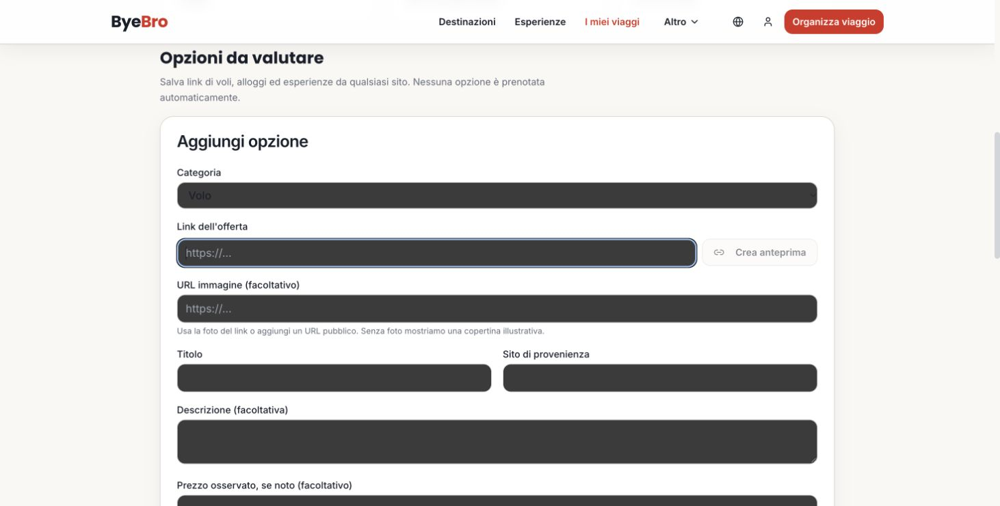
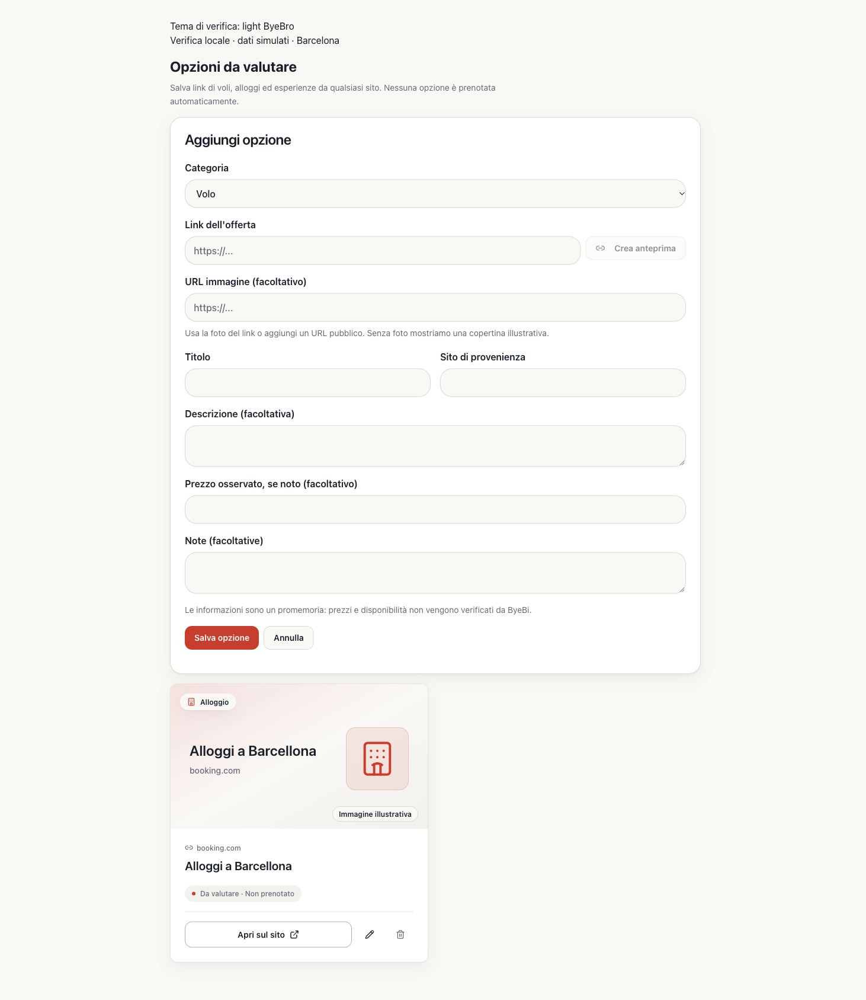
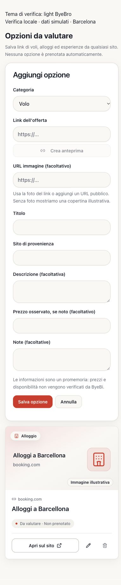

# Trip Options: verifica pubblicazione e regressioni

Verifica del 15 ottobre 2026, circa 23:30–23:44 Europe/Rome. Base GitHub aggiornata: `main` = `65e46e7f64d5480cd6eb0f83a6ecdaffcf367e59` (PR #54).

## Versione pubblica realmente osservata

È stato usato Chrome autenticato su `https://byebi.it/trips/24`, in una **nuova scheda**. La scheda originale conteneva una modifica non salvata ed è rimasta intatta. Le bozze create per la verifica sono state annullate: nessuna opzione o checklist salvata, modificata o eliminata.

Il documento pubblico, scaricato anche con una richiesta HTTP indipendente dal browser, restituisce HTTP 200 e `cache-control: private, max-age=0` e include:

- `/assets/index-C-gqobl3.js`
- `/assets/index-DUg50z0a.css`

L'inventario delle risorse effettivamente caricate dal Trip Hub include `/assets/TripHub-DGZ57NfX.js`. Il modulo pubblico contiene questo callback, qui abbreviato senza modificarne il comportamento:

```js
onSuccess:s=>{
  w(s.available?"":t("tripOptions.previewFallback")),
  l(c=>({...c,url:s.url,title:s.title,source:s.source,
    description:s.description??"",imageUrl:s.imageUrl??""}))
}
```

Il titolo viene assegnato incondizionatamente. Mancano sia il controllo di generazione sia la protezione dei campi presenti in #54. Nel DOM pubblico i controlli hanno ancora `rounded-md border px-3 py-2 text-base`, senza `bg-background` e `text-foreground`. Anche la copertina fotografica è quella precedente a #54.

**Conclusione verificabile:** gli asset frontend serviti non contengono le modifiche Trip Options di #54. Non è un'ipotesi fondata solo sul risultato visivo o sul nome hash. Non è possibile determinare l'esatto commit di tutta la pubblicazione o la revisione backend: manca un identificatore di build esposto. Non è stato ispezionato né modificato Replit.

SHA-256 delle risorse pubbliche scaricate:

| Risorsa | SHA-256 |
| --- | --- |
| TripHub-DGZ57NfX.js | `34377b50bc16cbb867be99eb1b1b825ff7a5b1fabdf7af529c6d4e38263055e1` |
| index-C-gqobl3.js | `08263e5c9166681d811a91d58bbb66967e2d324af361abc26a948b59631db3b6` |
| index-DUg50z0a.css | `d299e60e900d81df02d8b460aa89eb2bcf22a3bb85e794da1a13958a0ebe77cc` |

## Riproduzione autenticata e cascade CSS

Con URL `https://byebi.it/`, un titolo manuale inserito prima di «Crea anteprima» viene sostituito da «ByeBi - Viaggi di gruppo indimenticabili». Ripetendo l'anteprima e digitando durante «Caricamento…», il titolo manuale viene nuovamente sostituito. Sono state invocate solo anteprime di metadati, senza salvataggi. La risposta è stata verificata attraverso il valore finale del form; non è stato esportato traffico autenticato o materiale di sessione.

Computed styles pubblici su select, input e textarea, desktop 1470×745 e mobile 390×844:

- testo `rgb(25, 30, 42)`;
- sfondo `rgb(59, 59, 59)`;
- contrasto testo/sfondo **1,49:1**, inferiore a 4,5:1;
- `color-scheme: normal`;
- nessuna classe `.dark` su `html`.

Il CSS pubblico eredita il colore del testo sui controlli e non assegna uno sfondo a questi campi. La superficie scura osservata è quindi quella nativa del browser; non proviene da una regola `.dark` applicata al form. La scelta interna del browser/OS che determina quel colore non è stata modificata o attribuita a una preferenza specifica senza evidenza.

## Correzione su main + questa PR

#54 contiene già i token semantici di testo, sfondo e placeholder. Questa PR mantiene quei token e aggiunge `color-scheme: light` al solo form per rendere deterministici i controlli nativi. Non modifica i token globali, il plugin tema o altre pagine.

Le richieste di anteprima vengono invalidate a ogni modifica dell'URL, anche nel percorso A → B → A. Un campo toccato manualmente resta protetto anche se svuotato. Generazioni e controlli sullo stato attuale ignorano risposte ed errori obsoleti, annullamento, cambio editor e smontaggio. L'incolla di un URL valido imposta esattamente il link oggetto della richiesta, evitando la dipendenza dall'ordine paste/change.

Il titolo contestuale Booking viene mostrato solo se:

1. il titolo è esattamente `booking.com` o `www.booking.com`;
2. il dominio URL è esattamente Booking, senza sottodomini arbitrari;
3. il percorso è una pagina `searchresults[.locale].html`;
4. esiste un solo parametro `ss` e coincide con una destinazione del Saved Trip.

Una struttura specifica, un titolo personalizzato, una destinazione diversa o sconosciuta e un dominio imitazione mantengono il titolo originale. Per la città riconosciuta si usa la traduzione esistente: «Alloggi a Barcellona», “Accommodation in Barcelona”, “Alojamientos en Barcelona”. La visualizzazione non aggiorna dati salvati. Nessun prezzo, disponibilità o proprietà viene inventato.

## Verifica locale

Il componente reale e il CSS Vite sono stati renderizzati in una pagina di controllo temporanea, con LanguageProvider e React Query reali, dati **simulati** e endpoint preview esclusivamente locale, ritardato di 2,5 secondi. Nessuna connessione a Supabase o dati di produzione. I file di controllo temporanei sono stati rimossi e non fanno parte della PR.

Computed styles della correzione, desktop e mobile:

| Elemento | Testo | Sfondo | Contrasto |
| --- | --- | --- | --- |
| Input, select, textarea | RGB 25/30/42 | RGB 250/248/245 | **15,72:1** |
| Placeholder URL | RGB 100/106/120 | RGB 250/248/245 | **5,11:1** |

Rapporti calcolati dalla luminanza sRGB dei colori effettivi: entrambi superano 4,5:1 per testo normale. Su mobile non c'è overflow orizzontale. Con classe `.dark` applicata e variante ByeBride, gli stessi colori effettivi restano in vigore per la cascade corrente; non si assume un tema scuro globale pienamente implementato.

Il browser locale ha confermato la conservazione del titolo manuale prima e durante l'anteprima. I test di componente usano ora **useMutation reale**, al posto dello stub che lasciava sempre `isPending: false`, e includono modifiche manuali prima/durante, cancellazione del testo, URL A → B → A, successo/errore obsoleti, risposte fuori ordine, incolla sostitutivo, annulla/riapri e limiti del titolo Booking.

Validazione finale:

- `npm run check`;
- `npm test -- client/src/components/TripOptions.test.tsx client/src/pages/TripHub.test.tsx server/services/tripLinkPreview.test.ts`;
- `npm run build`, con variabili client locali fittizie, senza credenziali reali;
- `git diff --check`.

Esito: **35 test superati**, controllo TypeScript e build completati.

Il placeholder della home mobile resta fuori da questa correzione mirata. Le foto reali di strutture non erano disponibili nelle opzioni pubbliche osservate; la gestione del fallback delle immagini resta coperta dai test esistenti.

## Screenshot

Produzione, desktop:



Correzione locale con dati simulati, desktop:



Correzione locale con dati simulati, mobile:



Nessun merge, deploy, migrazione o operazione di acquisto è stato eseguito. La discrepanza della pubblicazione resta da risolvere in un'attività separatamente autorizzata.
